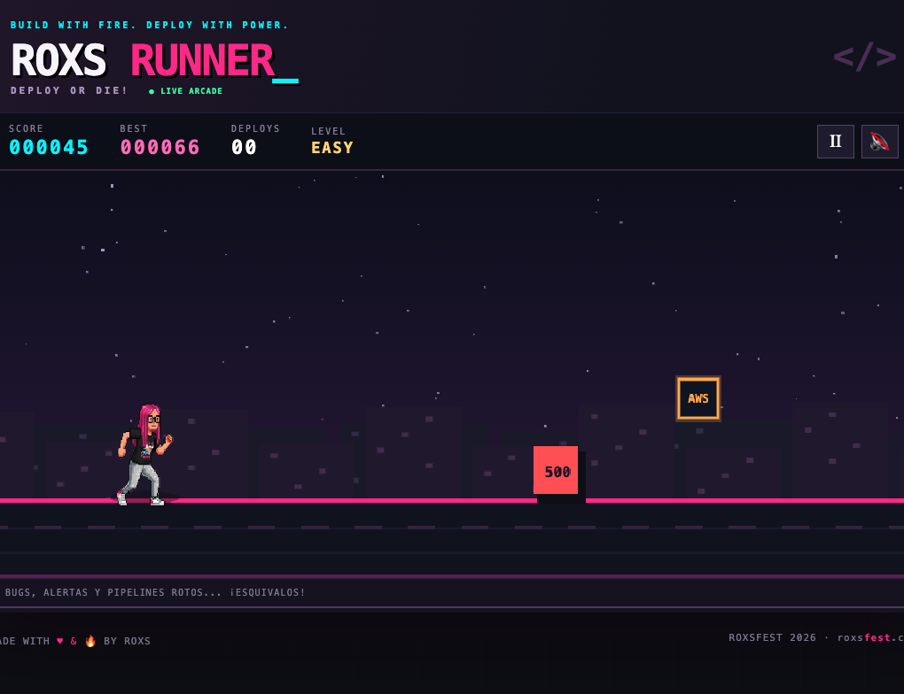

# 🎮 ROXS RUNNER · Práctica de la Clase 4


**ROXS RUNNER — Deploy or Die!** es un juego arcade donde Roxs corre hacia producción esquivando bugs, errores 500 y pipelines rotos. Lo creé para ROXSFEST 2026 y en el **Bootcamp AWS desde cero** (Código Facilito × AWS) lo llevamos a la nube.



Hoy vemos los tres modelos de cómputo con el mismo juego:

| Modelo | Qué corre | Dónde lo ves |
| --- | --- | --- |
| 🖥️ **EC2** (servidor) | El juego, servido por nginx en Ubuntu | `http://<IP>` · etiqueta “● EC2 · NGINX” |
| 📦 **Contenedor** | El mismo juego, empaquetado con Docker, en la misma EC2 | `http://<IP>:8080` · etiqueta “● CONTENEDOR DOCKER” |
| ⚡ **Lambda** (serverless) | La API del **ranking global** | `https://<id>.execute-api.<region>.amazonaws.com/ranking` |

```
roxs-runner-clase4/
├── juego/                  # el juego con ranking (se abre con doble clic)
│   ├── index.html
│   ├── style.css
│   ├── game.js             # el juego: avisa cuando termina la partida
│   ├── roxsfest.png
│   ├── config.js           # ← aquí va la URL de tu API del ranking
│   └── ranking.js          # muestra el formulario y el top 5 al perder
├── ec2/user-data.sh        # script de arranque: nginx (80) + contenedor (8080)
├── contenedor/Dockerfile   # el juego dentro de un contenedor
├── lambda/index.mjs        # la API del ranking
└── scripts/
    ├── probar-web.sh       # prueba la EC2 (puertos 80 y 8080)
    ├── probar-api.sh       # prueba la API del ranking (rutas, errores y CORS)
    └── api-local.mjs       # opcional: la API del ranking en tu compu (Node.js)
```

No hace falta saber Node.js ni instalar nada en tu computadora para hacer esta práctica. Docker y Node.js solo sirven para las pruebas locales opcionales.

---

## Cómo funciona todo

```
 Navegador                                   AWS
┌──────────────────────────────┐        ┌───────────────────────────────────────┐
│ index.html                   │        │ API Gateway (API HTTP)                │
│  ├─ game.js   → al perder    │        │  · rutas GET /ranking, POST /ranking  │
│  │   lanza "roxs:gameover"   │  HTTPS │  · CORS: responde al navegador        │
│  ├─ config.js → URL de la API│ ─────► │            │                          │
│  └─ ranking.js→ GET y POST   │ ◄───── │            ▼                          │
│      /ranking                │  JSON  │ Lambda roxs-runner-ranking            │
└──────────────────────────────┘        │  · lee event.routeKey                 │
                                        │  · guarda el ranking en memoria       │
                                        └───────────────────────────────────────┘
```

1. **El juego** (`game.js`) corre entero en el navegador. Tu récord (BEST) se guarda en el `localStorage` del navegador. Al perder, el juego lanza el evento `roxs:gameover` con tu puntaje.
2. **`config.js`** define `window.RANKING_API`. Si está vacío, `ranking.js` no hace nada y el juego funciona igual que siempre, sin ranking.
3. **`ranking.js`** escucha el evento. Muestra un campo para tu nombre, pide el top con `GET /ranking`, sube tu puntaje con `POST /ranking` y resalta tu fila en el **🏆 TOP 5 GLOBAL**.
4. **API Gateway** recibe la petición. Como el juego vive en otro dominio (o en tu disco), el navegador primero pregunta si puede llamar a la API: eso es **CORS**, y lo responde API Gateway, no el código.
5. **Lambda** (`lambda/index.mjs`) mira `event.routeKey` (por ejemplo `"POST /ranking"`) y decide qué hacer. El ranking es una lista en memoria: dura mientras Lambda reutilice el mismo entorno.

Qué responde la API:

| Petición | Respuesta |
| --- | --- |
| `GET /ranking` | `200` con el top 10: `[{"nombre":"Ana","puntaje":512,"fecha":"…"}]` |
| `POST /ranking` con `{"nombre":"Ana","puntaje":512}` | `201` con `{"posicion":1,"total":1}` |
| `POST` sin nombre, con puntaje fuera de 0 a 100000 o con un cuerpo que no es JSON | `400` con `{"error":"…"}` |
| Cualquier otra ruta | `404` con `{"error":"Ruta no encontrada"}` |

El nombre se recorta a 20 caracteres y el puntaje tiene que ser un número entero.

### Ejemplo de respuestas

Reemplaza `API` por la URL de tu API (o por `http://localhost:3000` si usas la API local).

```bash
API=https://<id>.execute-api.<region>.amazonaws.com
```

**Subir un puntaje** (`POST /ranking`):

```bash
curl -i -X POST "$API/ranking" \
  -H "Content-Type: application/json" \
  -d '{"nombre":"Ana","puntaje":512}'
```

```http
HTTP/2 201
content-type: application/json
access-control-allow-origin: *

{"posicion":1,"total":3}
```

**Ver el ranking** (`GET /ranking`). Llega ordenado de mayor a menor puntaje, con un máximo de 10 filas. `fecha` está en UTC, en formato ISO 8601:

```bash
curl -s "$API/ranking"
```

```json
[
  { "nombre": "Ana",  "puntaje": 512, "fecha": "2026-11-21T22:10:04.512Z" },
  { "nombre": "Roxs", "puntaje": 340, "fecha": "2026-11-21T22:08:51.107Z" },
  { "nombre": "Leo",  "puntaje": 66,  "fecha": "2026-11-21T22:05:30.940Z" }
]
```

La API devuelve el JSON en una sola línea. Aquí está formateado para que se lea mejor. Si el ranking está vacío, devuelve `[]`.

**Errores** (`400` y `404`):

```bash
curl -s -X POST "$API/ranking" -H "Content-Type: application/json" -d '{"puntaje":5}'
# {"error":"Falta el nombre"}

curl -s -X POST "$API/ranking" -H "Content-Type: application/json" -d '{"nombre":"Ana","puntaje":-1}'
# {"error":"Puntaje inválido"}

curl -s -X POST "$API/ranking" -H "Content-Type: application/json" -d 'hola'
# {"error":"El cuerpo debe ser JSON"}

curl -s "$API/otra-ruta"
# {"message":"Not Found"}
```

Una ruta que no existe en API Gateway, como `/otra-ruta`, nunca llega a la Lambda: responde API Gateway con `404` y `{"message":"Not Found"}`. El `{"error":"Ruta no encontrada"}` de la Lambda aparece con la API local, o en AWS cuando la ruta llega a la función con otro nombre (por ejemplo, con una API REST o con `ANY /ranking`).

---

## Paso 1 · En tu computadora (2 min)

Abre `juego/index.html` con doble clic y juega una partida.

Tu récord (BEST) se guarda solo en tu navegador: nadie más lo ve y nadie más puede jugar tu copia. Por eso llevamos el juego a la nube y le sumamos un ranking compartido.

### Pruebas locales opcionales

**El contenedor** (requiere Docker). Desde la carpeta `juego/`:

```bash
docker build -t roxs-runner -f ../contenedor/Dockerfile .
docker run --rm -p 8080:80 roxs-runner
# abre http://localhost:8080
```

**La API del ranking sin AWS** (requiere Node.js). `scripts/api-local.mjs` corre el mismo `lambda/index.mjs` en tu computadora y responde CORS como lo haría API Gateway. Desde la raíz del proyecto:

```bash
node scripts/api-local.mjs                       # API en http://localhost:3000
./scripts/probar-api.sh http://localhost:3000    # en otra terminal
```

**Todo junto:** con la API local corriendo, pon `window.RANKING_API = "http://localhost:3000";` en `juego/config.js` y abre `juego/index.html` (o reconstruye el contenedor). Al perder aparece el ranking. La API local acepta cualquier origen, incluso el doble clic; la de AWS no (ver [Lo que no puede fallar](#lo-que-no-puede-fallar)). Antes de subir tus cambios, deja `config.js` con la URL de tu API en AWS o vacío.

## Paso 2 · En AWS: EC2 con Ubuntu (20 min)

1. Inicia sesión en la consola de AWS y entra a **EC2** › **Lanzar instancia**.
2. **Nombre:** `roxs-runner-ec2`. Agrega la etiqueta `proyecto` = `roxs-runner`.
3. **Imagen (AMI):** Ubuntu Server 26.04 LTS.
4. **Tipo de instancia:** `t3.micro`.
5. **Par de claves:** “Continuar sin un par de claves” (no vamos a entrar por SSH).
6. **Configuración de red** › Editar:
   - Marca **Permitir el tráfico de HTTP desde Internet** (puerto 80).
   - **Agregar regla del grupo de seguridad:** tipo “TCP personalizado”, puerto `8080`, origen “En cualquier lugar”.
   - No abras SSH (22).
7. **Detalles avanzados** › **Datos de usuario:** pega todo el contenido de `ec2/user-data.sh`.
8. **Lanzar instancia**. Espera 3 a 5 minutos: el script descarga el juego desde GitHub e instala nginx y Docker.
9. Copia la **Dirección IPv4 pública** y abre:
   - `http://<IP>` → la etiqueta de arriba dice **● EC2 · NGINX**
   - `http://<IP>:8080` → la etiqueta dice **● CONTENEDOR DOCKER**

Usa `http://`, no `https://`: esta EC2 no tiene certificado 

Para probar desde la terminal (macOS, Linux o WSL):

```bash
chmod +x scripts/*.sh
./scripts/probar-web.sh <IP>
```

El script revisa los dos puertos y te dice qué etiqueta muestra cada uno. Si lo corres con `localhost` para probar el contenedor en tu compu, el puerto 80 sale ❌: es normal, ahí no hay nginx.

### ¿Qué hizo el script?

`ec2/user-data.sh` corre una sola vez, como `root`, cuando la instancia enciende por primera vez:

| Parte | Comandos | Idea |
| --- | --- | --- |
| 1 · Servidor web | `apt-get install -y nginx git`, `git clone` del repo y copia a `/var/www/html` | La EC2 descarga el juego y lo sirve, como una computadora en la nube |
| 2 · Contenedor | `apt-get install -y docker.io`, `docker build` con el `Dockerfile` y `docker run -p 8080:80` | Empaquetar el juego con su servidor y correrlo igual en cualquier lado |

En cada copia, un `sed` cambia la etiqueta `● LIVE ARCADE` por `● EC2 · NGINX` o `● CONTENEDOR DOCKER`. Así sabes desde dónde se sirve cada página.

El script descarga el juego original de [`roxsross/roxs-runner-fest`](https://github.com/roxsross/roxs-runner-fest), que **no tiene ranking**. Para servir el juego con ranking, mira la nota al final del Paso 3.

El `Dockerfile` tiene solo dos líneas:

```dockerfile
FROM nginx:alpine
COPY . /usr/share/nginx/html/
```

`FROM` parte de una imagen que ya trae nginx. `COPY` mete los archivos del juego en la carpeta que nginx sirve. Dentro del contenedor nginx escucha en el 80; `-p 8080:80` lo publica en el 8080 de la EC2.

### Si no carga

- Espera unos minutos más: el script tarda en terminar.
- Revisa el grupo de seguridad: deben estar abiertos los puertos 80 y 8080.
- Si ves la página de bienvenida de nginx, el script falló antes de copiar el juego.
- Para ver qué pasó sin SSH: selecciona la instancia › **Acciones** › **Monitoreo y solución de problemas** › **Obtener registro del sistema**.

### Al terminar

Selecciona la instancia › **Estado de la instancia** › **Terminar (eliminar) instancia**. Detenerla no alcanza: el disco sigue cobrando.

## Paso 3 · En AWS Lambda: la API del ranking (laboratorio)

La API tiene dos rutas:

| Ruta | Qué hace |
| --- | --- |
| `GET /ranking` | Devuelve el top 10 |
| `POST /ranking` | Guarda un puntaje: `{"nombre": "Ana", "puntaje": 512}` |

### ¿Qué es CORS?

El juego y la API viven en direcciones distintas. Por ejemplo, el juego en `http://localhost:8080` y la API en `https://<id>.execute-api.<region>.amazonaws.com`. Cada combinación de protocolo, dominio y puerto es un **origen**. Por seguridad, el navegador no deja que una página lea respuestas de otro origen, salvo que ese otro origen lo autorice.

**CORS** (*Cross-Origin Resource Sharing*, intercambio de recursos entre orígenes) es la forma de dar ese permiso. La API lo da con cabeceras en su respuesta:

| Cabecera | Qué le dice al navegador |
| --- | --- |
| `access-control-allow-origin: *` | Cualquier origen puede leer mis respuestas |
| `access-control-allow-methods: GET,POST` | Acepto estos métodos |
| `access-control-allow-headers: content-type` | Acepto que me mandes JSON con este encabezado |

Antes de un `POST` con JSON, el navegador manda una pregunta previa (*preflight*): un `OPTIONS` a la misma ruta. Si la respuesta no trae esas cabeceras, el navegador cancela el `POST` y el juego muestra “No se pudo subir”. Si falta `access-control-allow-origin` en el `GET`, muestra “No se pudo cargar el ranking”.

Por eso `curl` funciona aunque CORS esté mal: CORS lo aplica solo el navegador, y `curl` ignora esas cabeceras. En una API HTTP de API Gateway, las cabeceras las pone la propia API con su configuración de CORS. La Lambda no tiene que agregarlas.

### Con tu agente (plan A)

```text
Quiero desplegar la API del ranking de "ROXS RUNNER" como servicio
serverless en mi proyecto de AWS, en la región de mi proyecto.
- Una función Lambda en Node.js 24 llamada roxs-runner-ranking con
  el código de lambda/index.mjs.
- Una API HTTP de API Gateway con 2 rutas: GET /ranking y POST /ranking.
- CORS en la API: cualquier origen, métodos GET y POST,
  encabezado content-type.
- Rol de ejecución con permisos mínimos: solo escribir logs.
- Etiqueta todo con proyecto=roxs-runner.
- No crees EC2, NAT Gateway ni balanceadores.
Antes de crear nada, muéstrame el plan: recursos, permisos
y costo estimado. Espera mi confirmación.
```

### Desde la consola (plan B)

1. **Lambda** › **Crear función** › Crear desde cero › nombre `roxs-runner-ranking` › tiempo de ejecución **Node.js 24**. Deja el rol por defecto: solo permite escribir logs.
2. Pestaña **Código**: reemplaza el contenido de `index.mjs` por `lambda/index.mjs` › **Deploy**.
3. **API Gateway** › **Crear API** › **API HTTP** › Compilar › integración **Lambda** › `roxs-runner-ranking`.
4. Rutas: `GET /ranking` y `POST /ranking`, las dos a la misma función. Etapa `$default` con despliegue automático.
5. **CORS** (menú de la API › **CORS** › **Configurar**). En cada campo con botón **Add**, escribe el valor y toca **Add**; si no, no se guarda:

   | Campo | Valor |
   | --- | --- |
   | Access-Control-Allow-Origin | `*` |
   | Access-Control-Allow-Headers | `content-type` |
   | Access-Control-Allow-Methods | `GET`, `POST` (o `*`) |
   | Access-Control-Expose-Headers | vacío |
   | Access-Control-Max-Age | `0` (o `300`) |
   | Access-Control-Allow-Credentials | **NO**. Con origen `*` no puede ir en SÍ |

   Toca **Save**. Con la etapa `$default` y despliegue automático, el cambio se aplica solo.
6. Copia la URL de invocación y prueba:

```bash
./scripts/probar-api.sh https://<id>.execute-api.<region>.amazonaws.com
```

El script hace un `GET`, un `POST` válido (esperado `201`), uno inválido (esperado `400`) y revisa que CORS responda.

Para revisar CORS a mano, simula lo que hace el navegador antes del `POST`:

```bash
curl -i -X OPTIONS https://<id>.execute-api.<region>.amazonaws.com/ranking \
  -H "Origin: http://localhost:8080" \
  -H "Access-Control-Request-Method: POST" \
  -H "Access-Control-Request-Headers: content-type"
```

Tiene que responder `204` con estas cabeceras:

```text
access-control-allow-origin: *
access-control-allow-methods: POST
access-control-allow-headers: content-type
```

Si responde `204` sin ninguna cabecera `access-control-*`, a CORS le falta el origen o el encabezado. La URL sola (`…amazonaws.com/`) responde `404 Not Found`; es normal, la única ruta es `/ranking`.

### Lo que no puede fallar

- **API HTTP, no API REST.** El código lee `event.routeKey`, que solo llega en el formato de la API HTTP. Con una API REST o una URL de función, todo responde `404 Ruta no encontrada`.
- **Rutas exactas** `GET /ranking` y `POST /ranking`. Con `ANY /ranking` o `/{proxy+}` el código no las reconoce.
- **CORS en la API.** Sin CORS, `curl` funciona pero el juego muestra “No se pudo cargar el ranking”. El campo que más se olvida es **Access-Control-Allow-Origin**: si queda vacío, la API no devuelve ninguna cabecera CORS.
- **El juego por `http://`, no con doble clic.** Abierto como archivo (`file://`), el navegador manda `Origin: null` y API Gateway no lo cubre con `*`: responde sin cabeceras CORS y el ranking falla aunque la API esté bien. Sirve la carpeta `juego/` (ver [Conecta el juego al ranking](#conecta-el-juego-al-ranking)).
- **Etapa `$default`.** Si creas una etapa con nombre, por ejemplo `prod`, la URL pasa a ser `…/prod` y así tienes que copiarla en `config.js`.

### Conecta el juego al ranking

1. Abre `juego/config.js` y pega la URL de tu API, sin `/ranking` al final:

   ```js
   window.RANKING_API = "https://<id>.execute-api.<region>.amazonaws.com";
   ```

2. Sirve el juego por http. Con doble clic (`file://`) el ranking no carga, porque API Gateway rechaza el origen `null`. Elige una de estas dos opciones:

   **Opción A · Python** (viene instalado en macOS y Linux). Abre una terminal en la raíz del proyecto:
   ```bash
   cd juego
   python3 -m http.server 8080
   ```
   En Windows usa `python -m http.server 8080` (o `py -m http.server 8080`). Si dice que no encuentra Python, instálalo desde [python.org](https://www.python.org/downloads/) y marca **Add python.exe to PATH**.

   Abre `http://localhost:8080` en el navegador. Deja la terminal abierta mientras juegas; para apagar el servidor, presiona `Ctrl + C`. Si el puerto está ocupado, usa otro, por ejemplo `8081`.

   **Opción B · Live Server de Visual Studio Code.**
   1. En VS Code, abre la vista **Extensiones** (`Ctrl + Shift + X`, o `Cmd + Shift + X` en Mac), busca **Live Server** (de Ritwick Dey) e instálala.
   2. En el explorador de archivos, clic derecho sobre `juego/index.html` › **Open with Live Server**. También puedes abrir el archivo y tocar **Go Live** en la barra inferior.
   3. Se abre el navegador en una dirección como `http://127.0.0.1:5500/juego/index.html`. Cada vez que guardas un archivo, la página se recarga sola.
   4. Para apagarlo, toca **Port: 5500** en la barra inferior.

   Revisa que la barra del navegador empiece con `http://`. Si dice `file://`, abriste el archivo directo y el ranking no va a cargar. También sirven el contenedor de las pruebas locales o la EC2 del Paso 2.
3. Juega y, al perder, escribe tu nombre y toca **📤 SUBIR**. Aparece el **🏆 TOP 5 GLOBAL** con tu fila resaltada.
4. **Ranking de la clase:** si todos ponen en `config.js` la URL de la API de la instructora, compiten en un mismo ranking.

Deja la API viva: en la clase 6 el juego pasa a S3 + CloudFront y solo quien inicia sesión entra al ranking.

### Si el ranking no aparece

| Lo que ves | Qué revisar |
| --- | --- |
| No aparece el campo para tu nombre al perder | `config.js` está vacío o no guardaste el archivo |
| “No se pudo cargar el ranking. Revisa la URL de la API o CORS.” | 1) Que la barra del navegador diga `http://…` y no `file://…`. 2) Que `config.js` tenga la URL sin `/ranking`. 3) Que CORS tenga **Allow-Origin** `*` y **Allow-Headers** `content-type` (prueba con el `curl -X OPTIONS` del plan B). 4) En DevTools › **Network**, el código real de la respuesta: un `404` o `500` también se ve como error de CORS |
| “No se pudo subir: Ruta no encontrada” | Que sea una API HTTP y que las rutas se llamen exactamente así |
| `500 Internal Server Error` | Los logs: Lambda › `roxs-runner-ranking` › **Monitorear** › **Ver registros de CloudWatch** |

> **¿Por qué se borró mi récord?** La API guarda el ranking en memoria. Cuando Lambda crea un entorno nuevo, empieza de cero. Para que recuerde hace falta una base de datos, como DynamoDB.

> **¿Quieres que la EC2 también sirva el juego con ranking?** Sube el contenido de `juego/` (con tu `config.js`) a la raíz de tu propio repositorio de GitHub y cambia `REPO` en `ec2/user-data.sh` por la URL de ese repositorio. El script descarga lo que haya en la rama principal.

---

## Costos (plan gratuito 2026)

| Pieza | Costo aproximado | Nota |
| --- | --- | --- |
| El juego en tu computadora | $0 | — |
| EC2 t3.micro durante la clase (2 h) | centavos de tus créditos | ≈ $0,0104 por hora; termínala al final |
| Contenedor en la misma EC2 | $0 extra | Corre dentro de la misma instancia |
| Lambda + API HTTP | ≈ $0 | Lambda: 1 millón de solicitudes al mes siempre gratis |

Precios de referencia en us-east-1. Confírmalos en la calculadora de precios de AWS.

**Tengo fuego. Tengo superpower.** 🔥 · [roxsfest.com](https://roxsfest.com)
